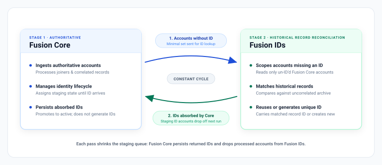
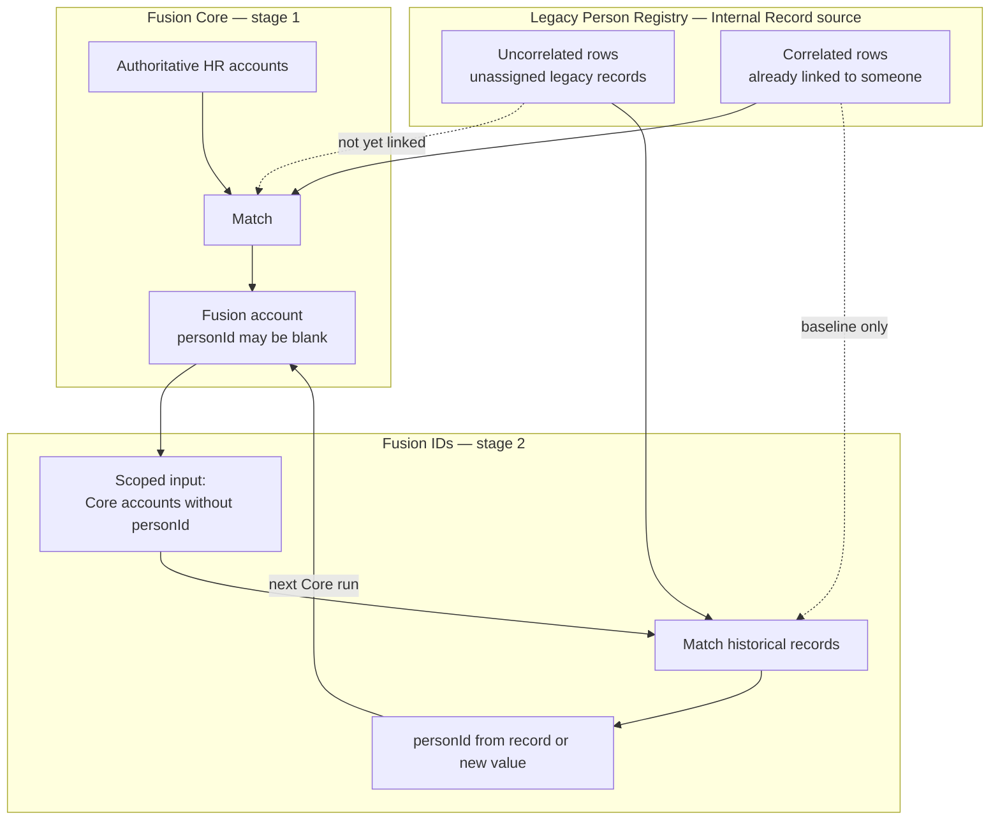
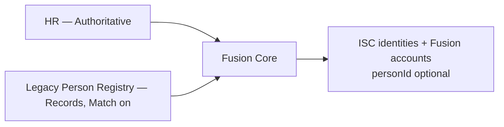
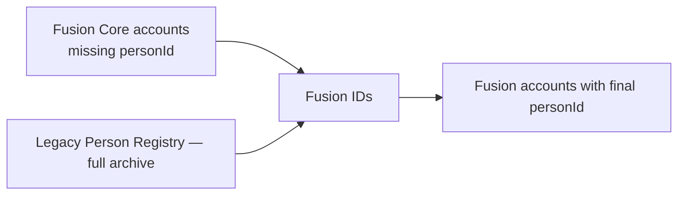

# Two-stage historical record reconciliation

Use this pattern when authoritative onboarding must **reconcile new joiners against a large historical record archive** so people can reclaim legacy attributes—including enterprise IDs—before they are promoted to active access. One Fusion connector (**Fusion Core**) owns **authoritative intake, lifecycle, and attribute merge**; a second (**Fusion IDs**) owns **matching against uncorrelated archive rows** and **writing the enterprise ID** when a record supplies one or when none match.

The two connectors exchange data on every aggregation. Each pass shrinks the work queue: Fusion Core absorbs IDs from Fusion IDs, and transient Fusion ID–side accounts drop off so the next ID pass only compares the **minimum set** of people still missing an ID against the archive.

**Configuration reference:** [Source Settings](../../configuration/source.md) · [Attribute Definition Settings](../../configuration/definition.md)

**Related guides:** [Source types](../configuration/source-types.md) · [Records customizer](../configuration/records-customizer.md) · [Configuring sources and scope](../configuration/configuring-sources-and-scope.md) · [Tune API performance](../operation/tune-api-performance.md)

!!! note "Didactic guide"
    This page explains **how and when** to deploy the pattern. For field keys, types, defaults, and constraints, see the linked **Configuration reference**.

---

## Pattern at a glance

| Pattern role | What it does | Example ISC source name | Assigns new enterprise ID? |
| --- | --- | --- | --- |
| **Fusion Core** (stage 1 · authoritative) | Ingests HR and related authoritative accounts; Match uses **correlated** historical rows to enrich identities; leaves `personId` empty when no legacy row is already tied to someone | `Campus Fusion Core` | **No** |
| **Fusion IDs** (stage 2 · record reconciliation) | Takes Fusion Core accounts **without** `personId` plus the **full** archive; Match compares joiners to **uncorrelated** rows; reuses a record ID or mints a new one | `Campus Fusion IDs` | **Yes** — Unique definition runs here only |

Names in this guide (`Campus`, `Legacy Person Registry`, `personId`) are **fictional**. Substitute your source names and attribute names.

### What problem this solves

Many organizations keep **years of person data** in flat files or legacy systems. Joiners are not “new IDs only” events: operations want the **same person record** (ID, prior attributes, affiliations) when someone returns or when HR data finally catches up to history. A single Fusion source that both onboards authority and scans millions of archive rows in one run can exhaust SaaS Connectivity runtime or memory. Splitting the work keeps authoritative lifecycle on one connector and **historical record matching** on another, coupled in a **constant cycle**.

---

## Constant cycle

Deployment is a **loop**, not a one-time migration. Two Fusion sources exchange data on every aggregation:



| Flow | Direction | What moves |
| --- | --- | --- |
| **1. Accounts without ID** | Fusion Core → Fusion IDs | Only Fusion Core accounts still missing `personId`—the minimal set for historical record lookup |
| **2. IDs absorbed by Core** | Fusion IDs → Fusion Core | `personId` (from a matched uncorrelated row or a new value) is persisted on the authoritative Fusion account; staging rows on Fusion IDs drop off on the next Core run |

Repeat **Core → IDs → Core** until every joiner has a final `personId` and you do not keep two Fusion accounts for one person.

Each pass shrinks the staging queue: Fusion Core persists returned IDs and drops processed accounts from Fusion IDs.

!!! tip "Staging lifecycle outside Fusion"
    Connector configuration does not set ISC lifecycle state. Pair this pattern with a **staging** lifecycle on the identity profile until `personId` is set, then promote to active. Joiners stay out of downstream access until the cycle finishes.

---

## How each stage uses the record archive

Package the archive once with the [Records customizer](../configuration/records-customizer.md) and attach the same Internal Record source to **both** connectors. Each stage uses a different **slice** of the dump:

| Slice | On **Fusion Core** | On **Fusion IDs** |
| --- | --- | --- |
| **Correlated records** | Rows already **linked** to an identity or Fusion account. They join the Match **baseline** and can **map** legacy fields (for example `personId`, prior department) onto the person during authoritative onboarding. | Treated as baseline only—**not** candidates to “hand out” an unused archive ID, because the row is already assigned. |
| **Uncorrelated records** | Rows still **unassigned**. They stay in the record source for Match but **do not** supply an ID until stage 2 assigns one (unless your rules correlate them directly on Core). | The **matching stock** for joiners missing `personId`: a strong Match **reserves** the archived ID for that person; registration prevents double use globally. |

**Different contributions, same file:**

- **Fusion Core** uses correlated history to **enrich** onboarding (reclaim details for people already known to the archive). Uncorrelated rows wait—they are not the Core’s job to assign.
- **Fusion IDs** uses uncorrelated history to **decide** which legacy ID (if any) belongs to each joiner still missing `personId`. Correlated rows guard against assigning an ID already tied to someone else.



---

## Fusion Core configuration (stage 1)

**Deployment mode:** [Umbrella mode](../../glossary.md#deployment-and-integration) — Fusion source **Authoritative** in ISC.

| Area | Recommended shape |
| --- | --- |
| Managed sources | Authoritative HR (and other lifecycle sources) **enabled** |
| Internal Record (`Legacy Person Registry`) | **Records**, **Internal** on, **Include record accounts in Match** **on** so **correlated** rows participate in baseline and Map |
| Attribute Definition | **No** Unique definition for `personId` (no generator on Core) |
| Match | Rules for authoritative onboarding and for linking to **already correlated** archive rows |
| Identity scope | Usually **off** when authoritative managed sources already represent the population |



**Batch authoritative intake:** Comparing a large wave of joiners to a multi-million-row archive in one run can exhaust memory or runtime. Set **Aggregation batch size** on authoritative sources ([Configuring sources and scope](../configuration/configuring-sources-and-scope.md)). Increase batch size only after timings stabilize. During initial bulk load, keep correlation in **Do not correlate** (or plan correlation separately) ([Managing correlation](../configuration/managing-correlation.md)).

---

## Fusion IDs configuration (stage 2)

**Deployment mode:** Usually **side-car** — Fusion source **not** authoritative for HR identity creation. This stage **reconciles historical records** and writes `personId`; it does not own full lifecycle.

| Area | Recommended shape |
| --- | --- |
| Managed sources | **Fusion Core** as **Authoritative accounts** managed source (scope/filter: `personId` empty) |
| Internal Record (`Legacy Person Registry`) | Same packaged dump as Core — **Records**, **Internal** on, **Include record accounts in Match** **on** |
| Attribute Definition | **Unique** definition for `personId` — [ID carryover expression](#id-carryover-expression) |
| Match | Stricter rules when **reusing** archive IDs; reviewers optional for borderline reuse |
| Other authoritative sources | **Off** — avoid competing identity-creation paths |



---

## ID carryover expression

Enterprise ID assignment is the **outcome** of historical record reconciliation on Fusion IDs. Define `personId` as a **Unique** attribute on **Fusion IDs** only. The expression should:

1. Prefer the matched **uncorrelated** archive row’s ID when Match linked one (`$sources`).
2. Preserve an ID already written on a prior Fusion IDs pass (`$previous`).
3. Otherwise mint a new value with collision handling (`$isUnique`, `$counter`).

Representative template (rename sources and fields to match your tenant):

```velocity
## personId — ID carryover (Fusion IDs only)
#if($sources.LegacyPersonRegistry && $sources.LegacyPersonRegistry.size() > 0)
  #set($rec = $sources.LegacyPersonRegistry[0])
  $rec.personId
#elseif($previous.personId && $previous.personId != "")
  $previous.personId
#else
  #set($base = $Normalize.ascii($firstname, "de")$Normalize.ascii($lastname, "de"))
  #if($isUnique($base))
    $base
  #else
    $base$counter
  #end
#end
```

Map the archive column to `personId` on the record source (for example `PERSON_ID` → `personId` in [Mapping attributes](../configuration/mapping-attributes.md)) so the `$rec.personId` branch resolves after Match.

On **Fusion Core**, map `personId` from the Fusion IDs managed source (or from identity attributes once correlated) with a **Normal** or passthrough map—still **without** a Unique generator—so Fusion IDs remains the single writer of new values.

See [Defining attributes](../configuration/defining-attributes.md) and [Velocity context](../../reference/velocity-context.md) for `$sources`, `$previous`, and `$isUnique`.

---

## Operational checklist

| Step | Action |
| --- | --- |
| 1 | Package the historical CSV with the Records Customizer; enable **Legacy Person Registry** on **both** connectors after the customizer image is deployed ([Records customizer](../configuration/records-customizer.md)). |
| 2 | Run **Fusion Core** (batched if volume is high). Confirm new joiners have blank `personId` when no **correlated** archive row matched. |
| 3 | Run **Fusion IDs**. Confirm Unique Define logs show `personId` from a record or a new value. |
| 4 | Run **Fusion Core** again. Confirm one Fusion account per person, `personId` persisted, and no duplicate staging accounts from Fusion IDs. |
| 5 | Dry-run either stage after tuning Match ([Analyze changes with dry-run](../operation/analyze-with-dry-run.md)). |

**Troubleshooting:** Fusion IDs scope includes accounts that already have `personId` → redundant work. Core defines a Unique `personId` → two writers conflict; remove it from Core. Archive enabled on only one connector → baselines diverge. Out-of-memory on large Match → reduce batch size and review [Records customizer — runtime memory](../configuration/records-customizer.md#benchmark-and-runtime-memory).

---

## Related guides

| Topic | Guide |
| --- | --- |
| Records packaging | [Records customizer](../configuration/records-customizer.md) |
| Record vs Authoritative behavior | [Source types](../configuration/source-types.md) |
| Batching and scope | [Configuring sources and scope](../configuration/configuring-sources-and-scope.md) |
| Shorter recipe index | [Match tuning cookbooks — Cookbook 4](../configuration/match-tuning-cookbooks.md#cookbook-4-two-stage-historical-record-reconciliation) |
| Performance | [Tune API performance](../operation/tune-api-performance.md) |
