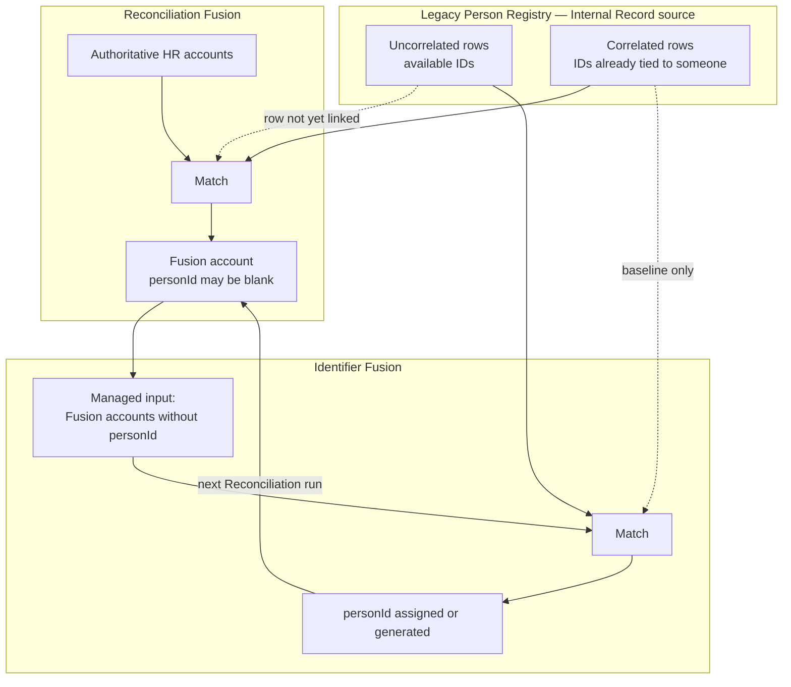
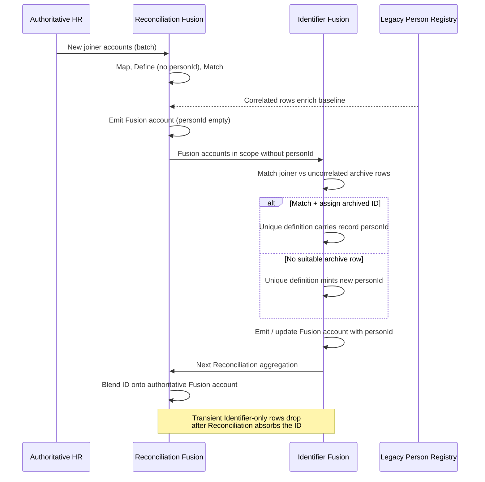
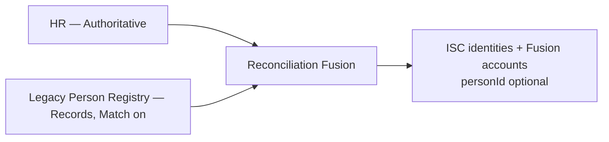
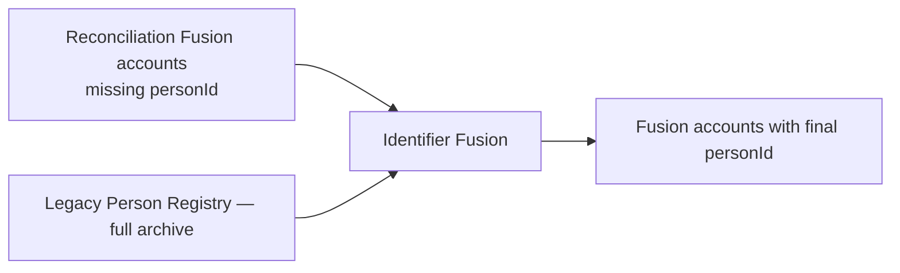

# Two-stage identifier reconciliation

Use this pattern when authoritative onboarding must **reconcile joiners against a large historical identifier archive** before every person receives a stable enterprise ID. One Fusion connector owns **person lifecycle and attribute merge**; a second Fusion connector owns **identifier assignment only**. The two connectors feed each other across repeated aggregations until each identity carries a final ID and duplicate staging accounts disappear.

**Configuration reference:** [Source Settings](../../configuration/source.md) · [Attribute Definition Settings](../../configuration/definition.md)

**Related guides:** [Source types](../configuration/source-types.md) · [Records customizer](../configuration/records-customizer.md) · [Configuring sources and scope](../configuration/configuring-sources-and-scope.md) · [Tune API performance](../operation/tune-api-performance.md)

!!! note "Didactic guide"
    This page explains **how and when** to deploy the pattern. For field keys, types, defaults, and constraints, see the linked **Configuration reference**.

---

## Pattern at a glance

| Role | Example ISC source name | Primary job | Generates enterprise ID? |
| --- | --- | --- | --- |
| **Reconciliation stage** | `Campus Reconciliation Fusion` | Ingest authoritative HR (and related) accounts; Match against identities and historical rows already linked to someone | **No** — leave the ID attribute empty until the ID stage writes it back |
| **Identifier stage** | `Campus Identifier Fusion` | Process Reconciliation Fusion accounts **missing** an enterprise ID plus the **full** historical archive; Match, reuse an archived ID, or mint a new one | **Yes** — Unique definition runs here only |

Historical rows are loaded through an [Internal Record source](../configuration/records-customizer.md) (packaged dump). Names in this guide (`Campus`, `Legacy Person Registry`, `personId`) are **fictional** — substitute your own source names and attribute names.

---

## How the two stages understand the record archive

The same Internal Record dump appears on **both** connectors, but each stage uses a different slice of it.

| Slice | Meaning on the Reconciliation stage | Meaning on the Identifier stage |
| --- | --- | --- |
| **Correlated records** | Historical rows whose Match outcome already **linked** them to an identity or Fusion account. They join the Match **baseline** and can **map** attributes (for example a reclaimed `personId`) onto the person during authoritative onboarding. | Treated like any other baseline identity — not candidates for “reuse this unused ID” because the row is already assigned. |
| **Uncorrelated records** | Rows still **unassigned** in the archive. They stay in the record source for Match but do not yet contribute an ID to a person. | Primary **matching stock** for joiners missing `personId`: a strong Match can **assign** the archived value; registration marks it reserved globally. |



**Contributions differ:**

- On **Reconciliation**, correlated records **enrich** identities during onboarding (carry forward legacy attributes). Uncorrelated records **do not** hand out IDs by themselves; they wait for Identifier-stage assignment or a direct Match link when your rules allow it.
- On **Identifier**, uncorrelated records are the **pool** for reuse; correlated records prevent double-assignment by sitting in the baseline instead of the reuse queue.

---

## End-to-end cycle

The deployment is a **loop**, not a one-time migration. Run Identifier after Reconciliation whenever new joiners appear without `personId`, then run Reconciliation again so authoritative attributes persist the ID and staging duplicates prune away.



!!! tip "Staging lifecycle outside Fusion"
    Connector configuration does not set ISC lifecycle state. In practice, pair this pattern with a **staging** lifecycle state on the identity profile until `personId` is populated, then promote to active in provisioning. That keeps joiners without a final ID out of downstream access until the loop completes.

---

## Reconciliation stage configuration

**Deployment mode:** [Umbrella mode](../../glossary.md#deployment-and-integration) — Fusion source **Authoritative** in ISC.

| Area | Recommended shape |
| --- | --- |
| Managed sources | Authoritative HR (and other lifecycle sources) **enabled** |
| Internal Record (`Legacy Person Registry`) | **Records**, **Internal** on, **Include record accounts in Match** **on** so correlated rows participate in baseline and Map |
| Attribute Definition | **No** Unique definition for `personId` (and no generator for the enterprise identifier you delegate to the ID stage) |
| Match | Rules tuned for reconciling joiners to historical identities and to **already correlated** archive rows |
| Identity scope | Usually **off** when the authoritative managed sources already represent the population |



**Batch authoritative intake:** Comparing a large wave of new joiners against a multi-million-row archive in a single run can exhaust memory or runtime. Use **Aggregation batch size** on authoritative sources ([Configuring sources and scope](../configuration/configuring-sources-and-scope.md)) so each run processes a deterministic slice. Increase batch size only after timings stabilize. Keep correlation in **Do not correlate** (or plan correlation separately) during the initial bulk load ([Managing correlation](../configuration/managing-correlation.md)).

---

## Identifier stage configuration

**Deployment mode:** Usually **side-car** — Fusion source **not** authoritative for HR identity creation. The stage exists to write `personId`, not to own full lifecycle.

| Area | Recommended shape |
| --- | --- |
| Managed sources | **Reconciliation Fusion** as an **Authoritative accounts** managed source (scope query or filter: accounts where `personId` is empty) |
| Internal Record (`Legacy Person Registry`) | Same packaged dump as Reconciliation — **Records**, **Internal** on, **Include record accounts in Match** **on** |
| Attribute Definition | **Unique** definition for `personId` — see [ID carryover expression](#id-carryover-expression) below |
| Match | Stricter rules when reusing archive IDs; reviewers optional for borderline reuse |
| Other authoritative sources | **Off** — avoid competing identity-creation paths |



---

## ID carryover expression

Define `personId` as a **Unique** attribute on the **Identifier** connector only. The expression should:

1. Prefer the matched **uncorrelated** archive row’s ID when Match linked one (`$sources`).
2. Preserve an ID already written on a prior Identifier pass (`$previous`).
3. Otherwise mint a new value with collision handling (`$isUnique`, `$counter`).

Representative template (rename sources and fields to match your tenant):

```velocity
## personId — ID carryover (Identifier stage only)
#if($sources.LegacyPersonRegistry && $sources.LegacyPersonRegistry.size() > 0)
  #set($rec = $sources.LegacyPersonRegistry[0])
  $rec.personId
#elseif($previous.personId && $previous.personId != "")
  $previous.personId
#else
  #set($base = $Normalize.ascii($firstname, "de")$Normalize.ascii($lastname, "de"))
  #if($isUnique($base))
    $base
  #else
    $base$counter
  #end
#end
```

Map the archive column to `personId` on the record source (for example map `PERSON_ID` → `personId` in [Mapping attributes](../configuration/mapping-attributes.md)) so the `$rec.personId` branch resolves after Match.

On **Reconciliation**, map `personId` from the Identifier-stage Fusion managed source (or from identity attributes once correlated) with a **Normal** or passthrough map — still **without** a Unique generator — so the ID stage remains the single writer of new values.

See [Defining attributes](../configuration/defining-attributes.md) and [Velocity context](../../reference/velocity-context.md) for `$sources`, `$previous`, and `$isUnique`.

---

## Operational checklist

| Step | Action |
| --- | --- |
| 1 | Package the historical CSV with the Records Customizer; enable **Legacy Person Registry** on **both** connectors after the customizer image is deployed ([Records customizer](../configuration/records-customizer.md)). |
| 2 | Run **Reconciliation** aggregation (batched if volume is high). Confirm new joiners appear with blank `personId` when no correlated archive row matched. |
| 3 | Run **Identifier** aggregation. Confirm `uncorrelated-sweep` / Unique Define logs show `personId` population. |
| 4 | Run **Reconciliation** again. Confirm a single Fusion account per person, `personId` persisted, and no duplicate staging accounts from the Identifier source. |
| 5 | Dry-run either stage after tuning Match ([Analyze changes with dry-run](../operation/analyze-with-dry-run.md)). |

**Troubleshooting:** Identifier scope accidentally includes accounts that already have `personId` → redundant work. Reconciliation defines a Unique `personId` → two writers fight; remove it. Archive enabled on only one connector → baselines diverge. Out-of-memory on large Match → reduce batch size and review [Records customizer — runtime memory](../configuration/records-customizer.md#benchmark-and-runtime-memory).

---

## Related guides

| Topic | Guide |
| --- | --- |
| Records packaging | [Records customizer](../configuration/records-customizer.md) |
| Record vs Authoritative behavior | [Source types](../configuration/source-types.md) |
| Batching and scope | [Configuring sources and scope](../configuration/configuring-sources-and-scope.md) |
| Shorter recipe index | [Match tuning cookbooks — Cookbook 4](../configuration/match-tuning-cookbooks.md#cookbook-4-two-stage-identifier-reconciliation) |
| Performance | [Tune API performance](../operation/tune-api-performance.md) |
